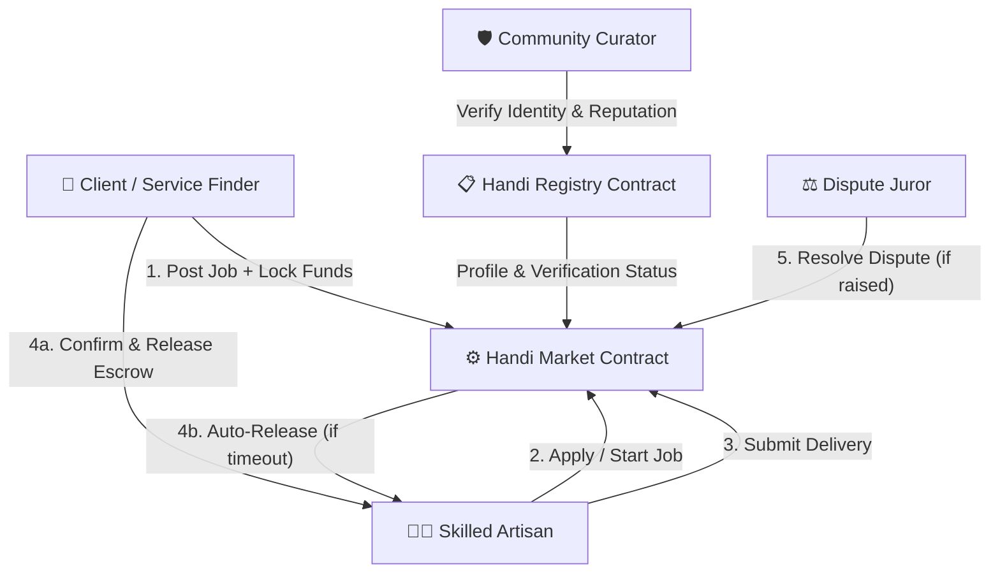

# 🛠️ Handi Protocol

> **Decentralized On-Demand Artisan & Freelance Infrastructure on Stellar Soroban**

[](https://opensource.org/licenses/MIT)
[](https://soroban.stellar.org)
[](https://www.rust-lang.org)
[]()

---

## 📌 Executive Summary

**Handi Protocol** is an open-source, trustless service marketplace protocol built natively on Stellar's **Soroban** smart contract framework. Handi connects local artisans, skilled tradespeople, and freelancers directly with clients seeking verified services—eliminating centralized marketplace fee gouging, middleman exploitation, and payment delay risks.

By combining on-chain escrow custody, automated deadline releases, decentralized community curator verifications, and multi-signature dispute resolution, Handi creates an end-to-end decentralized economy for real-world and digital services.

---

## 🏗️ Protocol Architecture

Handi Protocol is designed as a modular, upgradeable architecture consisting of two primary smart contracts working in synergy:



### 1. ⚙️ `contracts/market` (Handi Market)
Handles job lifecycles, payment escrowing, deadline management, and fee distributions.
* **Escrow Custody:** Holds job payments securely in XLM or SAC tokens until delivery is confirmed.
* **State Machine:** Enforces valid transitions (`Open` → `Assigned` → `InProgress` → `PendingReview` → `Completed` / `Disputed` / `Cancelled`).
* **Automated Safety:** Automatic fund release if client defaults past the review deadline, and timeout refund if assigned artisan fails to start work within 7 days.
* **Dispute Resolution:** Juror assignment mechanism allowing neutral arbitration when milestone delivery is contested.
* **Emergency Controls:** Admin pause switch and multi-step contract upgrade mechanism.

### 2. 📋 `contracts/registry` (Handi Registry)
Manages decentralized identities, skill credentials, and community verification.
* **Role Management:** Distinct permission levels for Clients (`Finder`), Artisans, Curators, and Network Admins.
* **Identity Verification:** Multi-step verification workflow where authorized Curators review identity metadata hashes (IPFS/Arweave).
* **Reputation Indexing:** Immutable record of artisan work history, verification state, and blacklist status.

---

## 📊 Performance & Gas Benchmarks

Resource usage and estimated execution fees for core marketplace functions measured using Soroban SDK's built-in invocation metering (`env.cost_estimate()`). Benchmarks reflect standard Mainnet pubnet rates (25 stroops / 10,000 instructions).

| Function Invocation | CPU Instructions | Memory Bytes | In-Memory Read Entries | Write Entries | Exec Fee (Stroops) | Approx. XLM Cost |
| :--- | :---: | :---: | :---: | :---: | :---: | :---: |
| **`create_job`** | 305,208 | 47,634 | 8 | 5 | ~97,157 | ~0.0097 XLM |
| **`confirm_delivery`** | 509,856 | 80,404 | 10 | 6 | ~118,569 | ~0.0119 XLM |

*Note: Benchmarks can be reproduced via `cargo test -p market --test bench -- --nocapture`.*

---

## 🌐 Web DApp Portal & Dashboard

Handi Protocol includes a standalone, high-performance web interface located in the `web/` directory.

### Key Web Features:
* **Interactive Contract Simulator:** Test creating jobs, applying as an artisan, confirming delivery, and resolving disputes with real-time state tracking.
* **Live Registry Directory:** Filter and discover verified artisans by skill category, verification badges, and rating scores.
* **Escrow Tracker:** Dynamic progress timelines showing milestone status, remaining timers, and locked balances.
* **Sleek Dark Mode & Modern Aesthetics:** Built with responsive CSS custom properties, glassmorphism card surfaces, and dynamic micro-animations.

To launch the web interface locally, simply open `web/index.html` in any modern web browser or serve it via your favorite local HTTP server:

```bash
# Python local server
python -m http.server 8000 -d web/

# Or Node npx http-server
npx http-server web/ -p 8000
```

---

## 🚀 Quickstart & Developer Guide

### Prerequisites
* [Rust](https://www.rust-lang.org/tools/install) (v1.75+)
* `wasm32-unknown-unknown` target:
  ```bash
  rustup target add wasm32-unknown-unknown
  ```
* [Stellar CLI](https://developers.stellar.org/docs/smart-contracts/getting-started/setup#install-the-stellar-cli) (optional, for Testnet/Mainnet deployment)

### 1. Build Smart Contracts
Compile WASM binaries for all contract packages:
```bash
cargo build --target wasm32-unknown-unknown --release
```
Optimized `.wasm` output files will be generated in `target/wasm32-unknown-unknown/release/`.

### 2. Run Test Suite
Execute unit and integration tests across all workspace contracts:
```bash
cargo test
```

### 3. Run Benchmark Tests
Run performance metering tests:
```bash
cargo test -p market --test bench -- --nocapture
```

---

## 🔒 Security Audit & Access Control

Handi Protocol smart contracts have undergone rigorous authorization verification.
* **Zero `env.invoker()` Usage:** All state mutations enforce explicit address authentication via `Address::require_auth()`.
* **Atomic State Updates:** State mutations occur strictly after authentication checks pass.
* **Emergency Safeguards:** Circuit-breaker pause functionality for market contracts.

Refer to [`SECURITY_AUDIT.md`](./SECURITY_AUDIT.md) for full compliance matrix and scope analysis.

---

## 📄 License

Handi Protocol is released under the open-source **[MIT License](LICENSE)**.
Created and maintained with ❤️ for the decentralized services ecosystem.
